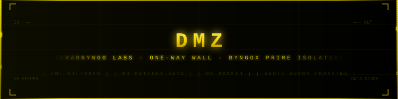
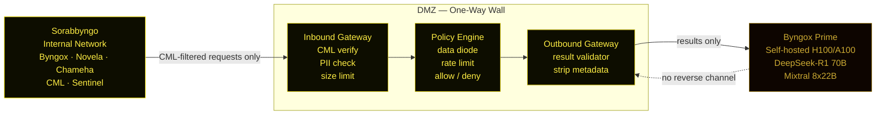
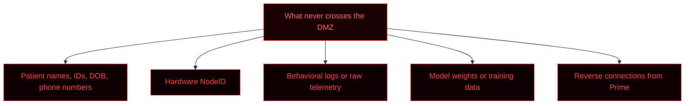
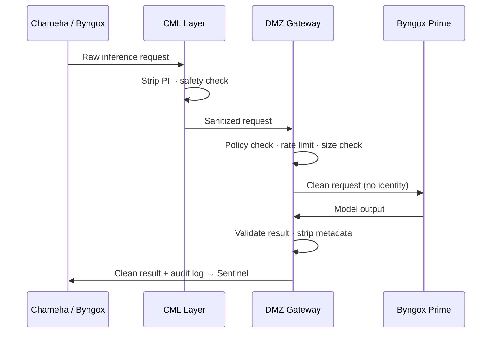

  

  <strong>Sorabbyngo DMZ — One-Way Wall</strong> 
  Byngox Prime isolation · Data diode · No reverse channel

  
  
  
  
  

---

The DMZ is a one-way data wall between the Sorabbyngo internal network and Byngox Prime — the self-hosted H100/A100 inference cluster. Data flows **in** to Prime. Results flow **out**. Nothing else crosses.

No patient data. No NodeIDs. No behavioral logs. No raw telemetry. Only sanitized, CML-filtered inference requests reach Prime. Only model outputs return — never raw model weights, never training data.

---

## Data flow

---

## Rules

| Rule | Description |
|---|---|
| No patient identifiers | Names, IDs, DOB, phone numbers stripped by CML before inbound gateway |
| No NodeID | Hardware identity never reaches Prime |
| No reverse channel | Prime cannot initiate connections inward |
| Rate limited | Max 100 requests per minute per node |
| Audit every crossing | Every request and response logged with SUID |
| Results validated | Prime output checked before returning inward |
| Opt-in only | Cloud/Prime calls require explicit user consent — ADR-009 |

---

## NATS subjects

| Subject | Direction | Purpose |
|---|---|---|
| `sorabbyngo.dmz.request` | Internal → DMZ | Sanitized inference request |
| `sorabbyngo.dmz.result` | DMZ → Internal | Validated inference result |
| `sorabbyngo.dmz.rejected` | DMZ → Internal | Rejected request + reason |
| `sorabbyngo.dmz.audit` | DMZ → Sentinel | Every crossing logged |

---

## What never crosses

---

## Request lifecycle

---

## Related repositories

| Repo | Role |
|---|---|
| `cml` | Sanitizes all requests before they reach the DMZ |
| `byngox` | Swarm engine — only Tier 4 calls cross the DMZ |
| `sentinel-runtime` | Receives audit log of every DMZ crossing |
| `identity-core` | SUID used to trace every crossing without exposing identity |
| `security` | DMZ enforces Ring 4 AI safety boundary |

---

  <strong>Sorabbyngo Company</strong> · Kisii, Kenya · 2026 
  <em>Rhythm of Digital Life</em>

